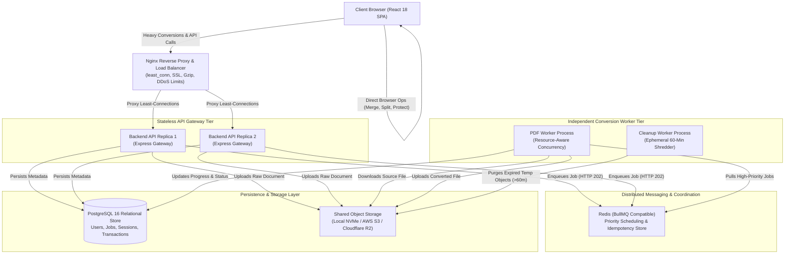

# SimplePDF Architecture & Technical Design

SimplePDF is an enterprise-grade, high-performance document platform architected for extreme concurrency, strict data privacy, horizontal elasticity, and zero vendor lock-in.

---

## 1. System Topology Overview

---

## 2. Core Architectural Pillars

### A. Dual-Tier Hybrid Processing Boundary
1. **Client-Side WebAssembly Tier:**
   - Over 60% of all platform operations (Merge PDF, Split, Rotate, Extract Pages, Watermark, Add Page Numbers, Encrypt/Protect, Flatten) execute entirely within the user's browser using `pdf-lib` compiled to JavaScript/WebAssembly.
   - **Benefits:** Zero server compute costs, zero file transfer latency, 100% data privacy (documents never leave the client device), and infinite edge scalability.
   - **Client Circuit Breaker:** If a network conversion fails or times out, the frontend automatically falls back to in-browser execution with toast notification.

2. **Distributed Cloud Worker Tier:**
   - Complex format transformations (Word `.docx`, Excel `.xlsx`, PowerPoint `.pptx`, deep document repair, and OCR) require heavy server CPU and memory.
   - The API Gateway does **not** process files inside the Express event loop; instead, it validates the upload, stores the file in the shared storage abstraction, registers the job in PostgreSQL, enqueues the payload into BullMQ/Redis, and immediately returns `HTTP 202 Accepted` with a `jobId`.

---

### B. Stateless API Gateway Cluster
- The API instances maintain zero in-memory application session state.
- Client authentication is validated via stateless, cryptographically signed JSON Web Tokens (JWT).
- Any incoming request can be served by any API replica without sticky sessions.
- Upstream load balancing is managed by Nginx using the `least_conn` algorithm, routing traffic away from temporarily busy instances.

---

### C. Distributed BullMQ/Redis Priority Queue
- **Priority Bands:** Paid accounts (`business` and `premium`) receive higher queue priority than `free` users, guaranteeing lower wait times during traffic surges.
- **Idempotency Protection:** Requests containing an `Idempotency-Key` header are tracked in an in-memory/Redis deduplication index. Duplicate clicks return the existing `jobId` without triggering duplicate processing.
- **Backpressure Protection:** When the waiting queue reaches `QUEUE_MAX_WAITING_JOBS` (default 100), new requests are immediately deferred with `HTTP 503 SERVICE_TEMPORARILY_OVERLOADED` rather than accepting work that causes cascading server OOM crashes.

---

### D. Independent Worker Architecture
- **Process Decoupling:** Workers run as separate OS processes (`node backend/dist/workers/index.js`) completely decoupled from API traffic.
- **Resource-Aware Concurrency:** The `ResourceMonitor` monitors live CPU utilization and `os.freemem()`. If free memory drops below 15% or CPU exceeds 85%, worker concurrency is dynamically throttled down to prevent kernel out-of-memory kills.
- **Retry Mechanics & Exponential Backoff:** Transient conversion failures automatically retry with exponential backoff (`delay = 2^attempts * 1000 ms`) up to 3 times before being marked `failed`.
- **Job Timeout Safeguard:** Conversions exceeding `JOB_TIMEOUT_MS` (default 3 minutes) are aborted via `Promise.race` to prevent hung child processes.

---

### E. Storage Abstraction Layer (`IStorageProvider`)
The storage layer provides unified read, write, delete, and signed-URL access across multiple storage drivers:

| Driver | Target Environment | Implementation Details |
|---|---|---|
| `local` | Development, Testing, Small VPS | Isolated directory trees with random hash subpaths (`/temp_storage/input/<jobId>/<hash>-file`). Strict path traversal protection. HMAC-SHA256 signed download tokens. |
| `s3` | AWS Production | Native AWS Signature Version 4 (SigV4) implementation without heavy external AWS SDK bloat. Direct presigned GET URLs with short expiration. |
| `r2` | Cloudflare Global Edge | Cloudflare R2 object storage endpoint with zero egress fee bandwidth. S3-compatible API. |

---

### F. Relational Data Layer & Graceful Fallback
- **Primary Relational Store:** PostgreSQL 16 managed via Prisma ORM schemas with explicit B-tree indexes on `(userId, createdAt)`, `status`, and `email`.
- **Resilient Fallback Mode:** In development or during unexpected PostgreSQL downtime, the `dbRepository` adapter seamlessly routes persistence to an ACID-safe JSON file store (`temp_storage/simplepdf_db.json`), guaranteeing that the application continues running even during database maintenance.

---

### G. Ephemeral Data Lifecycle & Zero-Exposure Policy
- Document files are strictly temporary.
- Every 15 minutes, the `CleanupWorker` scans the storage layer and permanently unlinks all input and output files exceeding `TEMP_FILE_TTL_MINUTES` (default 60 minutes).
- Local storage provider performs cryptographic zero-byte filling before unlinking to prevent forensic data recovery.
- Download endpoints enforce `Cache-Control: private, no-cache, no-store, must-revalidate` to prevent intermediary proxy caching of sensitive user PDFs.
