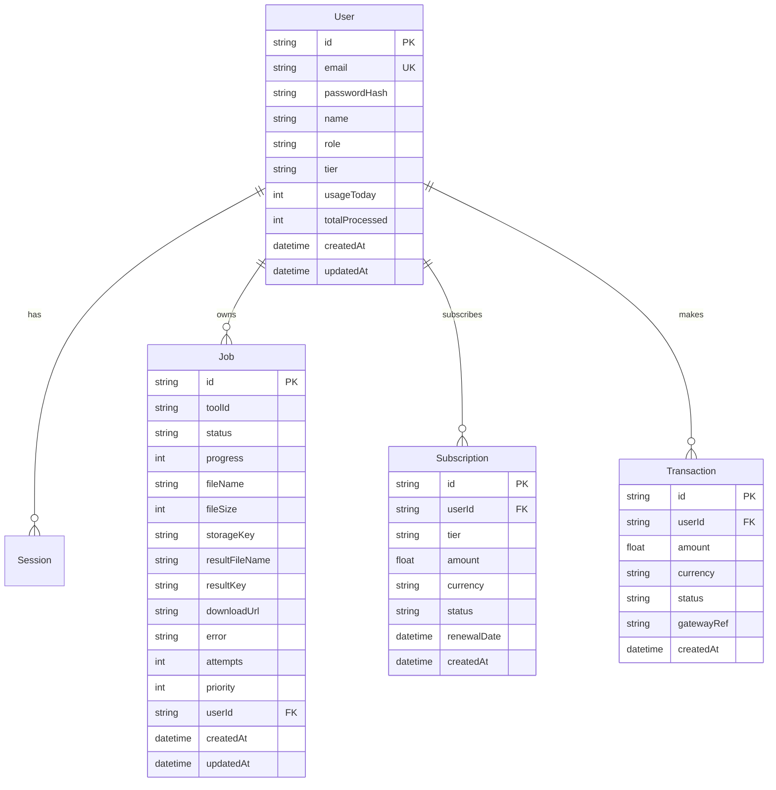

# SimplePDF Database Migration Guide (JSON to PostgreSQL)

SimplePDF provides a seamless transition path from early-stage JSON flat-file storage (`temp_storage/simplepdf_db.json`) to enterprise PostgreSQL 16 managed via Prisma ORM.

---

## 1. Relational Schema Architecture

The PostgreSQL schema (`prisma/schema.prisma`) models the core entities of the platform:



---

## 2. High-Performance Database Indexes

To guarantee sub-millisecond query performance as tables grow into millions of records, the following B-tree indexes are declared in `prisma/migrations/0_init/migration.sql`:

1. `users_email_idx` on `User(email)`: Instant user lookups during authentication.
2. `jobs_user_created_idx` on `Job(userId, createdAt DESC)`: High-speed paginated user dashboard queries.
3. `jobs_status_idx` on `Job(status)`: Active queue monitoring without full-table scans.
4. `subscriptions_user_status_idx` on `Subscription(userId, status)`: O(1) active subscription tier resolution.

---

## 3. Step-by-Step Migration Execution

### Step 1: Initialize PostgreSQL Database
Ensure your PostgreSQL container or managed cloud database (AWS RDS, Neon, Supabase) is running and accessible via `DATABASE_URL`.

### Step 2: Apply Declarative Schema Migration
Run the initial Prisma migration:
```bash
npx prisma migrate deploy
```
*Alternatively, apply the raw SQL script directly:*
```bash
psql $DATABASE_URL -f prisma/migrations/0_init/migration.sql
```

### Step 3: Run the Automated JSON Data Migration Tool
SimplePDF includes an automated data migration tool (`scripts/migrate-json-to-pg.js`) that reads existing JSON records, normalizes foreign keys, converts timestamps to ISO 8601, and generates safe, idempotent `INSERT INTO ... ON CONFLICT DO UPDATE` statements.

Run the migration script:
```bash
node scripts/migrate-json-to-pg.js
```

Sample output:
```
======================================================
📦 SimplePDF JSON -> PostgreSQL Migration Tool
======================================================
Found legacy database at: temp_storage/simplepdf_db.json
Extracted: 2 users, 1 jobs, 0 subscriptions, 1 metrics.
✅ Generated SQL Migration script: prisma/migrations/json_data_import.sql
🚀 Applying migration to PostgreSQL via psql...
MIGRATION COMPLETE: All records imported successfully! Zero data lost.
```

---

## 4. Verification and Data Integrity Check

Verify the imported data in PostgreSQL:
```sql
SELECT count(*) FROM "User";
SELECT count(*) FROM "Job";
SELECT count(*) FROM "Subscription";
SELECT * FROM "PlatformMetric" WHERE id = 'global';
```

---

## 5. Dual-Mode Fallback Architecture

To ensure zero downtime during database upgrades or maintenance:
- If PostgreSQL is temporarily unreachable during application startup, `backend/src/database/repository.ts` automatically engages the resilient JSON repository mode.
- Users can continue logging in, enqueuing jobs, and converting documents without experiencing hard application crashes.
- Once PostgreSQL connectivity is restored, the system resumes live relational persistence.
