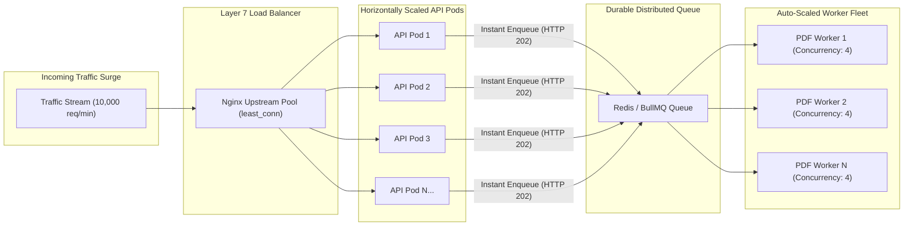

# SimplePDF Scalability & High-Throughput Engineering Guide

Scaling a PDF processing platform presents unique engineering challenges. Unlike a traditional CRUD web API that consumes negligible CPU per request, document processing operations (such as PDF rasterization, font embedding, OpenXML parsing, and compression) are heavily compute- and memory-intensive.

---

## 1. Golden Rule of PDF Platform Capacity

> **100 Website Visitors ≠ 100 Simultaneous PDF Conversions**

- An HTTP GET request to `/api/v1/auth/me` or `/api/health` takes **< 1 ms** of CPU and **< 50 KB** of RAM. One modern CPU core can serve **15,000+** of these requests per second.
- Converting a 50-page Word document with embedded tables and images to PDF takes **1.5 – 3.5 seconds** of CPU and **150 – 350 MB** of heap memory during rendering.
- Attempting to run 100 simultaneous heavy PDF conversions on a 4-core, 8 GB machine will cause instantaneous CPU pegging at 100%, event loop starvation, memory exhaustion, and operating system OOM kills.

SimplePDF solves this through **tiered separation of concerns**:
1. Edge offloading for client-executable operations.
2. Fast, stateless API instances that only validate and enqueue.
3. Dedicated worker processes governed by active resource monitoring.

---

## 2. Horizontal vs. Vertical Scaling Architecture



---

## 3. Worker Sizing & Concurrency Matrix

Use this sizing table to calculate worker concurrency based on host resources:

| Host Specifications | Safe Worker Count | Concurrency Per Worker | Total Concurrent Conversions | Peak Conversions / Hour |
|---|---|---|---|---|
| **2 vCPU, 4 GB RAM** | 1 | 2 | 2 | ~1,800 / hr |
| **4 vCPU, 8 GB RAM** | 2 | 3 | 6 | ~5,400 / hr |
| **8 vCPU, 16 GB RAM** | 4 | 4 | 16 | ~15,000 / hr |
| **16 vCPU, 32 GB RAM** | 8 | 4 | 32 | ~35,000 / hr |
| **Cloud Auto-Scaled Fleet** | Dynamic (1–50) | 4 | Up to 200 | ~200,000+ / hr |

---

## 4. Resource Monitor & Dynamic Backpressure

The built-in `ResourceMonitor` (`backend/src/services/resourceMonitor.ts`) acts as an automated shock absorber:

1. **Continuous Telemetry:**
   - Samples `os.freemem()` and process RSS.
   - Computes system CPU utilization.
2. **Dynamic Concurrency Throttling:**
   - Normal state: Workers consume jobs up to `WORKER_CONCURRENCY` (default 4).
   - Under heavy load (CPU > 85% or Free RAM < 15%): Concurrency is automatically halved.
   - Critical memory state (Free RAM < 5%): Concurrency drops to strictly 1 job at a time.
3. **Queue Backpressure Safeguard:**
   - When the Redis waiting queue depth reaches `QUEUE_MAX_WAITING_JOBS` (default 100), the API immediately returns `HTTP 503 SERVICE_TEMPORARILY_OVERLOADED`.
   - The user interface displays a polite retry prompt without crashing the backend.

---

## 5. Storage Scalability: Moving from Local NVMe to Cloudflare R2 / AWS S3

When scaling beyond a single host:
- Local storage (`STORAGE_DRIVER=local`) requires shared NFS/EFS mounts across multiple instances.
- **Recommended Production Solution:** Set `STORAGE_DRIVER=r2` or `STORAGE_DRIVER=s3`.
  - Input files uploaded directly to Cloudflare R2 / AWS S3.
  - Workers fetch files directly from S3 using signed requests.
  - Output files saved to S3; client receives presigned download URLs.
  - Zero disk I/O contention on application servers.
  - Cloudflare R2 provides **zero egress bandwidth fees**, saving thousands in CDN bills.

---

## 6. PostgreSQL Database Connection Pooling

Under high concurrency, thousands of simultaneous Express handlers can overwhelm PostgreSQL's maximum connection limit (`max_connections = 100`).

SimplePDF implements connection pool management:
- Configurable limits via `DB_POOL_MIN` and `DB_POOL_MAX`.
- For extreme scale (> 100,000 daily active users), place **PgBouncer** in transaction pooling mode between the API instances and PostgreSQL.

```
API Replicas (x10) ──> PgBouncer (Port 6432) ──> PostgreSQL (Port 5432)
  [200 connections]      [Pool of 20 connections]
```
